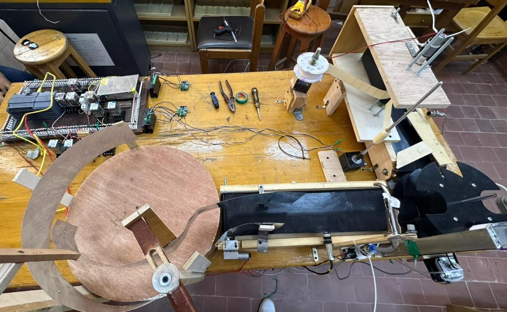
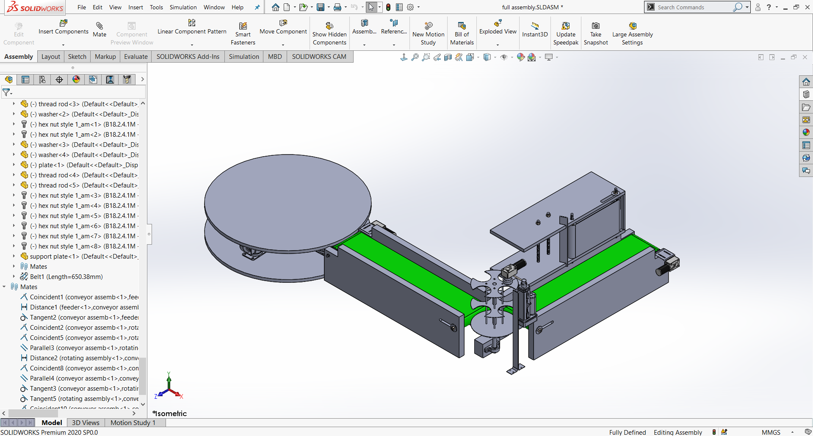
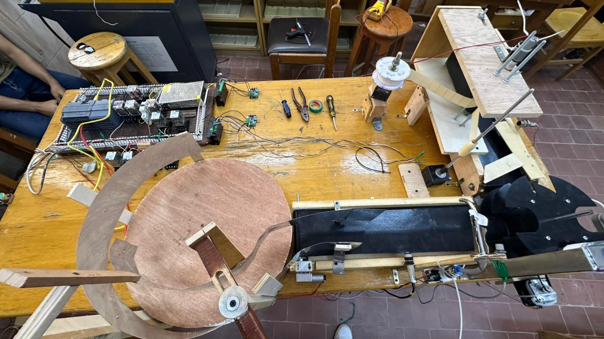
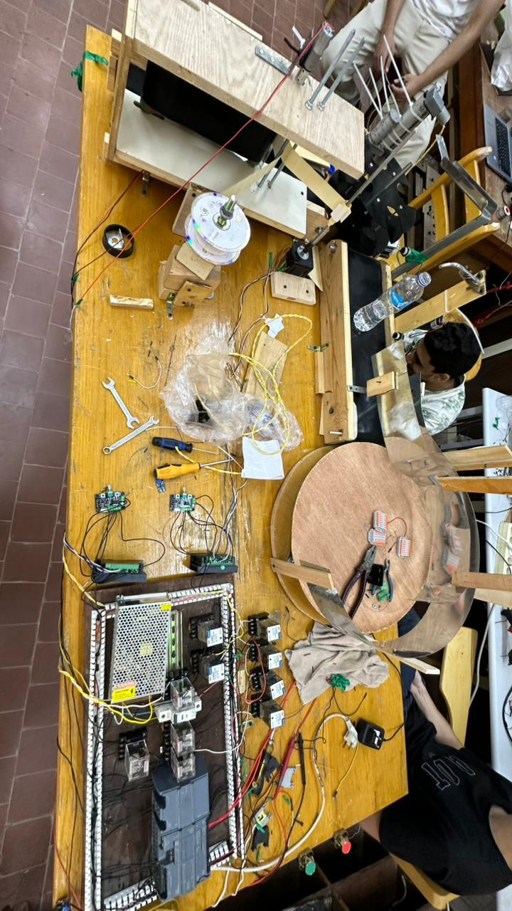

# 🏭 Design and Implementation of an Automated Production Line for Filling, Capping, and Packaging 

### From empty bottle to packed product, fully automated.

---

## 🕹️ Simulation

▶️ **[Watch the simulation](Simulation.mp4)**

---

## 🎥 The Real System in Action

▶️ **[Watch the real system running](REAL_LIFE_VIDEO.mp4)**

---

## 💡 The Idea

Manual bottling is slow and inconsistent: every bottle ends up with a slightly
different amount of liquid.

This graduation project solves that with a **PLC-controlled production line**
that fills, caps, and packages bottles automatically, with consistent quality
and minimal human intervention.

## 🎯 My Role: Precision Filling

I focused on the **heart of the line: the filling stage**.

> **Target:** a filling error of **2% or less**, so every bottle gets
> the right amount, every time.

## ⚙️ How the Line Works

| Stage | What happens |
|-------|--------------|
| 🍼 **1. Filling** | A sensor detects the bottle, the valve opens, and the volume is dispensed |
| 🔒 **2. Capping** | The cap is placed and sealed |
| 📦 **3. Packaging** | Finished bottles are organized and ready for delivery |

## 📸 Behind the Scenes

### 🛠️ Design (CAD)

### 🔧 Assembly

  
  

## 🛠️ Tech Stack

- **Controller:** PLC siemens1200
- **Programming:** Ladder Logic (LAD) & Function Block Diagram (FBD)
- **Design:** CAD model of the full line

## 📩 Contact

📧 ahmed.saafan.eng@gmail.com
🔗 [LinkedIn](www.linkedin.com/in/ahmed-saafan-a37401320)

---

⭐ Thanks for stopping by!

