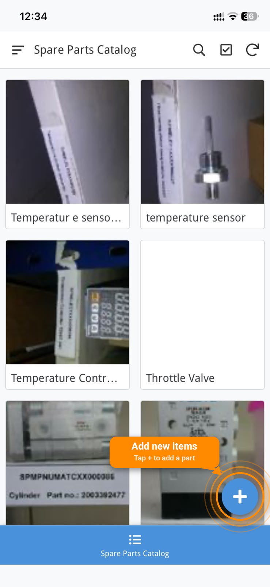

# Ahmed Mohamed Saafan

### Mechatronics Engineer | Industrial Automation & Maintenance

**B.Sc. Mechatronics Engineering, Fayoum University (Class of 2026)**

[About](#about-me) · [Featured Projects](#featured-engineering-projects) · [Portfolio Directory](#portfolio-directory) · [Skills](#technical-skills)  · [Contact](#contact)

---

## About Me

Mechatronics Engineering graduate specializing in **Industrial Automation and Maintenance**, and former intern at **Edita Food Industries**.

I demonstrated my technical capabilities through an intensive engineering internship at Edita Food Industries, focusing on **high-speed packaging lines, maintenance, sensor calibration, and P&ID schematics**. I am passionate about optimizing control systems and troubleshooting complex electro-mechanical equipment, and I build practical digitalization tools that reduce machine downtime.

---

## Featured Engineering Projects

### 1. Automated Bottle Filling, Capping & Packaging Line
*Graduation project*

**Context:** An end-to-end automated production line integrating mechanical fabrication, industrial sensors, and PLC logic.

**My role and impact:** I engineered, calibrated, and tested the **precision liquid-filling stage**, achieving a filling volume error of **≤ 2%** using closed-loop flow feedback and PLC control.

**[Open the project folder with videos and CAD →](./05_PLC_Automation/Filling-Capping-Line)**

---

### 2. Industrial Spare-Parts Catalog & Lookup System
*Edita Food Industries internship · Deployed and in active use*

<table>
<tr>
<td width="230" align="center">

</td>
<td valign="top">

**The problem:** During breakdowns, technicians searched paper files or waited on the storekeeper to look up part codes, which took at least ~20 minutes. That wait counts directly toward machine repair time (MTTR).

**What I built:** A mobile-first, offline-capable, bilingual (EN/AR) catalog with photo verification, search and category filtering, and in-field data entry. I designed, built, and deployed it independently within a 2-month internship.

**Impact:**
- Part lookup in **under 5 seconds** instead of ~20 minutes (approximate, based on shop-floor practice)
- Actively used by **6 maintenance technicians** across **~500 spare parts**
- Reduces **MTTI / MTTR** during machine breakdowns

**[Read the full case study with demo video →](./06_Industrial_Digitalization)**

</td>
</tr>
</table>

---

## Portfolio Directory

| Folder | Focus Area | Key Contents & Implementations |
| :--- | :--- | :--- |
| [**`01_Basics`**](./01_Basics) | Control Fundamentals & Logic | Foundational electrical control circuits, relay logic, and industrial automation building blocks. |
| [**`02_Sensors`**](./02_Sensors) | Industrial Instrumentation | Wiring, calibration, and interfacing of proximity, capacitive, photoelectric, and flow sensors. |
| [**`03_Motors`**](./03_Motors) | Actuators & Drive Systems | Motor control circuits, switching protection, speed regulation, and power stage fundamentals. |
| [**`04_Projects`**](./04_Projects) | Applied Mechatronics & Embedded | Hardware prototyping, microcontroller integration, and electro-mechanical systems. |
| [**`05_PLC_Automation`**](./05_PLC_Automation) | PLC Programming & Production Lines | Siemens TIA Portal projects, factory simulations, and the **Automated Filling & Packaging Line**. |
| [**`06_Industrial_Digitalization`**](./06_Industrial_Digitalization) | Smart Maintenance & Shop-Floor Tools | **Edita Spare-Parts Catalog App**: bilingual mobile lookup system reducing breakdown MTTR. |

---

## Technical Skills

| Area | Tools & Technologies |
|:---|:---|
| **PLC & Industrial Automation** | Siemens TIA Portal, `S7-1200` / `S7-300` / `S7-1500`, `LAD`, `FBD`, `PLCSIM` |
| **Control & Drives** | Classic control circuits, motor drives |
| **Instrumentation & Pneumatics** | Industrial sensors (proximity, capacitive, photoelectric, flow), pneumatics, solenoid valves |
| **Industrial Digitalization** | Google AppSheet, Microsoft Excel, Google Drive, data modeling for maintenance tools |
| **Maintenance** | Preventive and corrective maintenance |

---

## Contact

